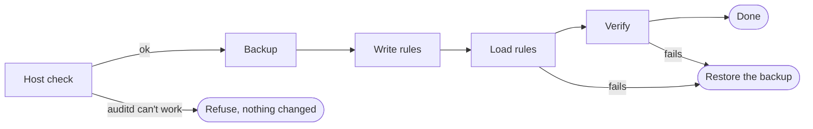

# auditd-kit

[](https://github.com/spydisec/auditd-kit/releases/latest)
[](https://github.com/spydisec/auditd-kit/actions/workflows/integration.yml)
[](https://github.com/spydisec/auditd-kit/actions/workflows/security.yml)
[](https://deepwiki.com/spydisec/auditd-kit)

auditd-kit installs a tested set of Linux audit rules (auditd) with one command. It keeps the
rules and agents that are already on the host, checks that events are recorded, and can undo the
change. It is plain POSIX shell, and it adds no packages and leaves nothing running.

auditd-kit is at `0.x`, so settings can still change between releases.

## Install

Run the command as root on a host that has auditd.

```sh
curl -fsSL https://github.com/spydisec/auditd-kit/releases/latest/download/get.sh | sudo sh
```

`get.sh` downloads the latest release into `/opt/auditd-kit`, checks it against `SHA256SUMS`, asks
which profile you want, and shows each change before it makes any. RHEL 10 also needs the `tar`
and `initscripts-service` packages.



## Profiles

| Profile | Use it for |
|---|---|
| `minimal` (default) | Every server. |
| `medium` | Critical servers. It also logs the commands that logged-in people run. |
| `heavy` | Hosts that must meet CIS or STIG audit checks. |

Each profile includes the one before it, and the rule keys are named after MITRE ATT&CK
techniques. [rules/README.md](rules/README.md) lists the rule files and shows how to add your own
rules or leave some out.

## Commands

Run the scripts from `/opt/auditd-kit/auditd-kit-<version>`, or from a copy of the repo.

| Command | What it does |
|---|---|
| `sh scripts/install.sh --profile medium --dry-run` | Shows each change and makes none. |
| `sh scripts/install.sh --profile medium` | Installs, or updates an earlier install. |
| `sh scripts/verify.sh` | Checks that auditd is running, the rules are loaded, and a test event is recorded. |
| `sh scripts/rollback.sh` | Restores the newest backup. `--list` prints the backups, and `--original` restores the host from before the first install. |
| `sh scripts/backup.sh` | Backs up `/etc/audit` without installing anything. |
| `sh scripts/stats.sh` | Shows the log volume for each day, and which rule keys, programs, and users write the most. |

Each script's header lists all of its flags.

| Exit code | Meaning |
|---|---|
| 0 | Done. |
| 1 | Refused, and nothing changed. Each reason prints as `refuse=<code> detail=<what to do>`. |
| 2 | A check failed, and install restored the backup. |
| 3 | The restore failed too, so a person must fix the host. |

## Settings

Pass a setting as a flag, e.g. `--skip-keys`, or as a `key=value` line in a file that you name
with `--config FILE`.

| Setting | Default | What it does |
|---|---|---|
| `akit_profile` | `minimal` | `minimal`, `medium`, or `heavy`. |
| `akit_size` | `standard` | `small`, `standard`, or `large`: the backlog and the log file sizes. |
| `akit_max_log_file`, `akit_num_logs` | from `akit_size` | Your own log file size in MB and number of log files. |
| `akit_skip_keys` | none | Rule keys to leave out on this host. |
| `akit_existing_rules` | `keep` | `keep` leaves other files in `/etc/audit/rules.d/` as they are. `replace` removes them. |
| `akit_immutable` | `false` | `true` locks the rules until reboot (`-e 2`), so a later change or rollback needs a reboot. |

## When install refuses

Install refuses only when auditd-kit can't work on the host.

| Code | Reason |
|---|---|
| `not_root` | Install isn't running as root. |
| `auditd_missing` | `auditctl` or `augenrules` isn't installed, or auditd is older than 2.8. |
| `audit_off` | The kernel has audit turned off. |
| `low_disk` | The audit log filesystem has less than 1.5 times the chosen log size free. |
| `tar_missing`, `service_missing` | The `tar` or `service` command isn't installed. |
| `agent_needs_audit:<agent>` | An agent reads the audit events itself, so auditd gets none: osquery with `disable_audit=false`, or Auditbeat with its own audit rules or a unicast socket. |
| `existing_rules_panic` | A kept rule file sets `-f 2`, which would panic the host when auditing fails. |

## Tested systems

auditd-kit runs on any Linux host that has auditd 2.8 or later with `augenrules`.

| System | Test on each change |
|---|---|
| Ubuntu 22.04, 24.04, 26.04 | Install, verify, and rollback on a real kernel. |
| CentOS 7, Rocky Linux 8, 9, 10 | The same test in a VM, on that system's own kernel. |
| Ubuntu 18.04, 20.04 | Install and rollback in a container, where rules can't be loaded. |
| Any other system | Not tested. Install prints a warning and goes ahead. |

## More

- [docs/guide.md](docs/guide.md): hosts that already have rules or agents, locked rules, and
  many hosts.
- [docs/integrations/send-audit-log.md](docs/integrations/send-audit-log.md): send the events to
  your SIEM. [wazuh.md](docs/integrations/wazuh.md) adds Wazuh alert rules for each rule key.
- [docs/adr/](docs/adr/): the design decisions.
- [CONTRIBUTING.md](CONTRIBUTING.md), [SECURITY.md](SECURITY.md), and
  [AI-DECLARATION.md](AI-DECLARATION.md), which says how AI tools are used.

## Licence

[Apache-2.0](LICENSE)
